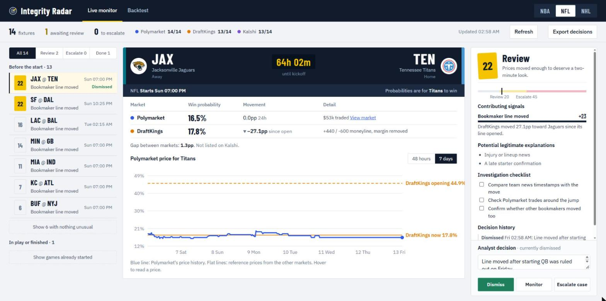
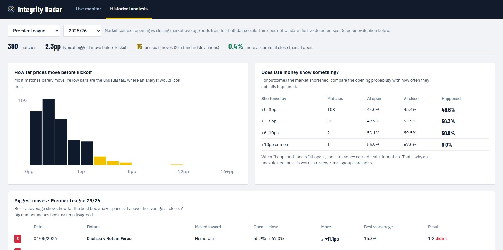

# Integrity Radar

**A tool that spots unusual betting-price moves before a game starts, so a person can check them.**


## The idea in one minute

When someone knows something they shouldn't about a game (a fixed result, a hidden injury), it often shows up in the prices first. Money pours in on one side and the odds move.

Today that money doesn't only go to bookmakers. **Prediction markets** like Polymarket and Kalshi, where people buy and sell "Team X wins" for real money, now handle millions per game. Few people watch them alongside the bookmakers.

Integrity Radar watches both. For every NBA, NFL and NHL game today and tomorrow, it:

1. **Collects the prices** from Polymarket, Kalshi and the bookmaker DraftKings.
2. **Turns them into a simple number**: the chance each market gives the home team to win (for example, 32%).
3. **Looks for anything odd**, such as the markets disagreeing, a price jumping sharply within a couple of hours, or one market moving while the others don't.
4. **Gives each game a score from 0 to 100** and lists the games worth a closer look first.
5. **Explains the score in plain words** and suggests innocent reasons, like an injury announcement.
6. **Lets the analyst decide**: dismiss it, keep watching, or escalate it.

The tool never accuses anyone. A high score only means "a person should look at this."

## Who it's for

Sports integrity analysts: the people at leagues, data companies and regulators who protect games from match-fixing. They can't watch every market by hand, so the tool narrows hundreds of prices down to the few games that need a human.

## What you see

**The daily review screen.** On the left, today's games, with the most unusual first. In the middle, the game's details: what each market says, and a chart of how the price changed over the past week. On the right, why the game was flagged and the buttons to decide.

Colour works like a referee's card: a **yellow card** means "worth a review" and a **red card** means "escalate".

**Recording a decision.** Here an analyst checked a big price move on an NFL game, found it was explained by the starting quarterback being ruled out, and dismissed it with a note. Every decision is kept with its reason and time.



**Learning from past seasons.** The backtest page uses five European football leagues to show how much prices normally move before kickoff, so you know what "unusual" looks like. It also checks whether late price moves turned out to be right.




## Try it yourself

You need [Python](https://www.python.org/downloads/) installed (version 3.9 or newer). Nothing else: no accounts, no keys, no installs.

1. Download this project (green **Code** button → **Download ZIP**) and unzip it.
2. Open a terminal in the folder and run:
   ```bash
   python server.py
   ```
3. Open **http://localhost:8765** in your browser.

Prices are live, so what you see depends on which games are on today.

## Where the data comes from

All free and public:

- **ESPN**: the game schedule and DraftKings' betting odds
- **Polymarket** and **Kalshi**: prediction-market prices
- **football-data.co.uk**: historical odds for past football seasons

## What's next

This is a prototype built with public data. With professional data feeds, the next steps would be to:

- Add the exact time of team news, so moves caused by injuries explain themselves
- Learn better thresholds from analysts' past decisions
- Have AI draft the case summary for the analyst (written from fixed templates today)
- Cover football's three-way markets (home, draw, away) live

## More detail

Scoring rules, the built-in API and the exact data endpoints are in [TECHNICAL.md](TECHNICAL.md). The visual design plan is in [DESIGN.md](DESIGN.md).

---

*A portfolio prototype for discussion. It is not betting advice, and a high score is not evidence of wrongdoing.*
