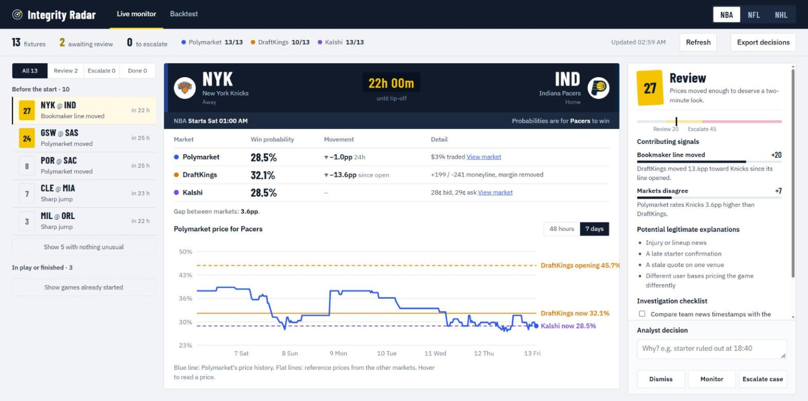
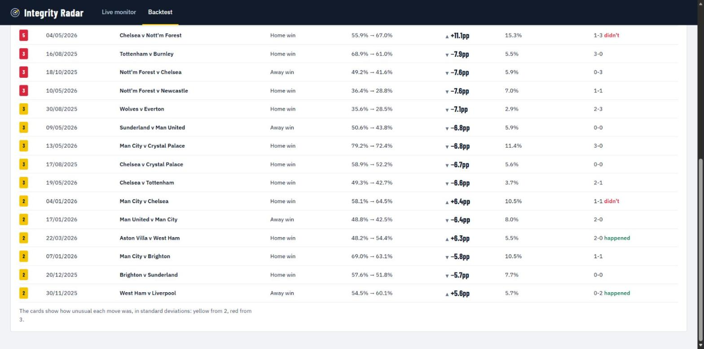

# Integrity Radar

A prototype that puts bookmaker odds and prediction-market prices side by side, so an integrity analyst can see which fixtures deserve a closer look before kickoff.



It matches each NBA, NFL and NHL fixture across Polymarket, Kalshi and DraftKings, scores unusual pre-match price behaviour, and gives the analyst a review queue with an explainable score, a case summary and a decision log.

## Quick start

Needs Python 3.9 or newer. There are no dependencies to install and no API keys or accounts.

```bash
python server.py
```

Then open http://localhost:8765.

## Product brief

### The problem
Suspicious pre-match money tends to show up first where regulation and liquidity are thinnest. Prediction markets like Polymarket and Kalshi now trade millions per game, but they sit outside traditional bookmaker monitoring, and no analyst can watch every market by hand.

### Who it's for
The integrity analyst. Their job: *"Show me the few fixtures today where prices behave strangely across markets, tell me why in plain language, and let me record my decision."*

### How it works
- Matches each fixture across ESPN, Polymarket and Kalshi automatically
- Turns every price into a margin-free win probability
- Looks for cross-market gaps, sharp jumps, and prediction-market moves the bookmaker didn't follow
- Counts signals for less in thin markets, where a few small orders can move the price
- Scores pre-match trading only, because in-play moves follow the score

### How we'd measure it
- **Precision:** share of flagged fixtures an analyst escalates
- **Time to review** each case, aiming for under two minutes
- **Coverage:** fixtures matched on at least two markets
- **Lead time** between the first signal and the bookmaker's line move

### Responsible AI
- It never accuses anyone. It ranks fixtures for a person to review.
- Every score breaks down into the signals behind it
- Every case summary lists innocent explanations first
- Decisions are logged with reasons, which builds a labelled set for tuning

### Next, with real data
- Swap public feeds for professional odds and live-event feeds
- Add team-news timestamps so common moves explain themselves
- Learn thresholds from analyst decisions
- Have an LLM draft case summaries from the structured signals (templated today)
- Extend to three-way soccer markets and exchange volumes

### Limits of this prototype
Public data only. ESPN shows one bookmaker's opening and current line, not its full history. Polymarket history is sampled every 30 minutes and Kalshi shows current quotes only. Thresholds are set by hand. Nothing here is an integrity verdict on a real fixture.

## Views

**Live monitor.** A queue of today's and tomorrow's fixtures ranked by review score, an evidence column (scorebug, market comparison, annotated Polymarket price chart) and a case panel (score breakdown, case summary, checks, and a Dismiss / Monitor / Escalate decision). Decisions are stored in the browser and can be exported as CSV.

**Backtest.** Opening vs closing odds for five European soccer leagues over three seasons: how far prices usually move before kickoff, whether late moves predicted results, and the biggest movers of the season.

### Screenshots

The image at the top shows the NBA live monitor: the queue on the left, the evidence in the middle, the case panel on the right. There, DraftKings moved 13.6pp toward the Knicks since opening, while Polymarket and Kalshi sit 3.6pp lower.

**Recording a decision (NFL).** The analyst dismisses a 27pp line move with a reason. The queue marks it as dismissed and the decision history keeps the note and time.


**Backtest overview (Premier League 2025/26).** How far prices moved before kickoff, and whether outcomes the market shortened happened more often than their opening odds implied.


**Biggest pre-match moves.** Each card shows how unusual the move was in standard deviations: yellow from 2, red from 3.



## Signals and scoring

| Signal | Fires when | Notes |
|---|---|---|
| Markets disagree | Polymarket and the bookmaker differ by 3pp or more | Weighted by Polymarket volume |
| Bookmaker line moved | DraftKings moved 4pp or more since opening | |
| Polymarket moved | 5pp or more over 24 hours before kickoff | Weighted by volume |
| Sharp jump | 6pp or more inside a two-hour window | Weighted by volume |
| Bookmaker didn't follow | Polymarket moved 5pp+ while DraftKings moved under 2pp | |
| Kalshi disagrees | Kalshi and Polymarket differ by 6pp or more | |

Scores are capped at 100. **Review** from 20, **Escalate** from 45.

## API

`server.py` serves the page and a small JSON API on `http://localhost:8765`. The page uses only these two endpoints, so you can also call them from scripts or notebooks.

### `GET /api/live?league={nba|nfl|nhl}`

Today's and tomorrow's fixtures for one league, matched across all three markets and scored. Games come back sorted by score, highest first.

```bash
curl "http://localhost:8765/api/live?league=nba"
```

Abbreviated response (one game shown):

```json
{
  "league": "nba",
  "generated": "2026-11-13T02:00:27+00:00",
  "coverage": { "fixtures": 13, "polymarket": 13, "book": 10, "kalshi": 13 },
  "games": [
    {
      "id": "401909296",
      "name": "New York Knicks at Indiana Pacers",
      "start": "2026-11-14T00:00Z",
      "state": "pre",
      "home": { "abbreviation": "IND", "name": "Pacers", "color": "0c2340" },
      "away": { "abbreviation": "NY", "name": "Knicks", "color": "1d428a" },
      "book":   { "provider": "DraftKings", "homeNow": 0.321, "homeOpen": 0.457, "rawHome": "+199", "rawAway": "-241" },
      "pm":     { "homeNow": 0.285, "volume": 38502, "move24": -0.01, "maxJump": 0.04, "history": [[1793390430, 0.39], "..."] },
      "kalshi": { "homeNow": 0.285, "bid": 0.28, "ask": 0.29 },
      "divergence": -3.6,
      "bookMove": -13.6,
      "score": 27,
      "level": "watch",
      "reasons": [
        { "code": "book_move",  "pp": -13.6, "pts": 20.4 },
        { "code": "divergence", "pp": -3.6,  "pts": 6.5 }
      ]
    }
  ]
}
```

| Field | Meaning |
|---|---|
| `state` | `pre` (before the start), `in` (in play) or `post` (finished) |
| `book.homeNow`, `book.homeOpen` | Bookmaker win probability for the home team, now and at opening, with the margin removed |
| `pm.homeNow` | Polymarket price for the home team (0–1). `pm.history` is `[unix_time, price]` pairs every 30 minutes over 7 days |
| `pm.move24`, `pm.maxJump` | Change over the 24 hours before kickoff, and the largest move inside any two-hour window |
| `kalshi.homeNow` | Midpoint of Kalshi's bid and ask for the home team |
| `divergence`, `bookMove`, `kalshiGap` | Differences in percentage points (pp) |
| `score`, `level` | 0–100 review score; `normal` below 20, `watch` from 20, `alert` from 45 |
| `reasons` | The signals behind the score, each with its size (`pp`) and points added (`pts`) |

A missing `book`, `pm` or `kalshi` object means that market doesn't list the fixture.

### `GET /api/backtest?div={E0|D1|SP1|I1|F1}&season={YYYY}`

One soccer season's opening vs closing odds. `div` is the league (Premier League, Bundesliga, La Liga, Serie A, Ligue 1) and `season` is four digits, e.g. `2526` for 2025/26.

```bash
curl "http://localhost:8765/api/backtest?div=E0&season=2526"
```

The response has season stats (`n`, `meanAbsDrift`, `brierOpen`, `brierClose`), a `buckets` table comparing opening probabilities with how often outcomes happened, and a `matches` list. Each match has its `open` and `close` probabilities for home/draw/away, the biggest move (`driftPP`), how unusual it was (`z`), the bookmaker spread at close (`dispersion`) and the result.

### Errors

Bad parameters return `400`, and a failing upstream source returns `502`, both as `{"error": "..."}`.

## Data sources

All public, no registration and no API keys:

| Source | Endpoint used | Used for |
|---|---|---|
| ESPN | `site.api.espn.com/apis/site/v2/sports/{sport}/{league}/scoreboard` | Fixtures, team details, DraftKings opening and current moneyline |
| Polymarket Gamma API | `gamma-api.polymarket.com/events?series_id=…` | Game markets and current prices |
| Polymarket CLOB API | `clob.polymarket.com/prices-history?market={token}` | 7-day price history |
| Kalshi | `api.elections.kalshi.com/trade-api/v2/markets?series_ticker=…` | Second prediction market (current bid and ask) |
| football-data.co.uk | `football-data.co.uk/mmz4281/{season}/{div}.csv` | Historical opening and closing odds for backtests |

These are unofficial or public endpoints and may change without notice. The server caches responses for 60–120 seconds (an hour for backtest CSVs) to keep request volume low.

## Project structure

```
server.py     Data fetching, fixture matching, scoring, local web server (standard library only)
index.html    Single-page interface (no build step)
DESIGN.md     Visual design plan
docs/         Screenshots used in this README
```

## Disclaimer

This is a portfolio prototype for discussion. It is not betting advice, and a high score is not evidence of wrongdoing.
