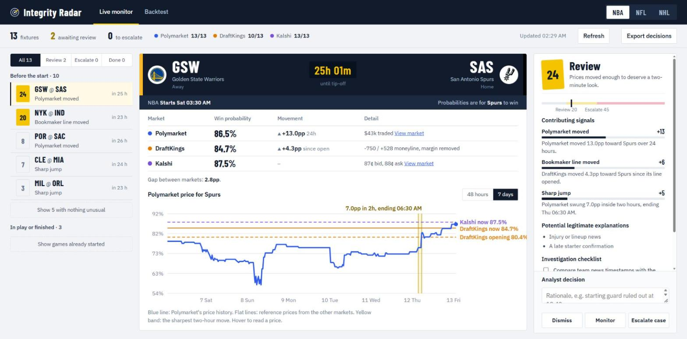

# Integrity Radar

A prototype that puts bookmaker odds and prediction-market prices side by side, so an integrity analyst can see which fixtures deserve a closer look before kickoff.



It matches each NBA, NFL and NHL fixture across Polymarket, Kalshi and DraftKings, scores unusual pre-match price behaviour, and gives the analyst a review queue with an explainable score, a case summary and a decision log.

## Quick start

Needs Python 3.9 or newer. There are no dependencies to install and no API keys or accounts.

```bash
python server.py
```

Then open http://localhost:8765.

## Product brief

### The problem
Suspicious pre-match money tends to show up first where regulation and liquidity are thinnest. Prediction markets like Polymarket and Kalshi now trade millions per game, but they sit outside traditional bookmaker monitoring, and no analyst can watch every market by hand.

### Who it's for
The integrity analyst. Their job: *"Show me the few fixtures today where prices behave strangely across markets, tell me why in plain language, and let me record my decision."*

### How it works
- Matches each fixture across ESPN, Polymarket and Kalshi automatically
- Turns every price into a margin-free win probability
- Looks for cross-market gaps, sharp jumps, and prediction-market moves the bookmaker didn't follow
- Counts signals for less in thin markets, where a few small orders can move the price
- Scores pre-match trading only, because in-play moves follow the score

### How we'd measure it
- **Precision:** share of flagged fixtures an analyst escalates
- **Time to review** each case, aiming for under two minutes
- **Coverage:** fixtures matched on at least two markets
- **Lead time** between the first signal and the bookmaker's line move

### Responsible AI
- It never accuses anyone. It ranks fixtures for a person to review.
- Every score breaks down into the signals behind it
- Every case summary lists innocent explanations first
- Decisions are logged with reasons, which builds a labelled set for tuning

### Next, with real data
- Swap public feeds for professional odds and live-event feeds
- Add team-news timestamps so common moves explain themselves
- Learn thresholds from analyst decisions
- Have an LLM draft case summaries from the structured signals (templated today)
- Extend to three-way soccer markets and exchange volumes

### Limits of this prototype
Public data only. ESPN shows one bookmaker's opening and current line, not its full history. Polymarket history is sampled every 30 minutes and Kalshi shows current quotes only. Thresholds are set by hand. Nothing here is an integrity verdict on a real fixture.

## Views

**Live monitor.** A queue of today's and tomorrow's fixtures ranked by review score, an evidence column (scorebug, market comparison, annotated Polymarket price chart) and a case panel (score breakdown, case summary, checks, and a Dismiss / Monitor / Escalate decision). Decisions are stored in the browser and can be exported as CSV.

**Backtest.** Opening vs closing odds for five European soccer leagues over three seasons: how far prices usually move before kickoff, whether late moves predicted results, and the biggest movers of the season.

## Signals and scoring

| Signal | Fires when | Notes |
|---|---|---|
| Markets disagree | Polymarket and the bookmaker differ by 3pp or more | Weighted by Polymarket volume |
| Bookmaker line moved | DraftKings moved 4pp or more since opening | |
| Polymarket moved | 5pp or more over 24 hours before kickoff | Weighted by volume |
| Sharp jump | 6pp or more inside a two-hour window | Weighted by volume |
| Bookmaker didn't follow | Polymarket moved 5pp+ while DraftKings moved under 2pp | |
| Kalshi disagrees | Kalshi and Polymarket differ by 6pp or more | |

Scores are capped at 100. **Review** from 20, **Escalate** from 45.

## Data sources

All public, no registration:

| Source | Used for |
|---|---|
| [ESPN scoreboard API](https://site.api.espn.com/apis/site/v2/sports/basketball/nba/scoreboard) | Fixtures, team details, DraftKings opening and current moneyline |
| [Polymarket Gamma + CLOB API](https://docs.polymarket.com/) | Prediction-market prices and 7-day price history |
| [Kalshi public market API](https://docs.kalshi.com/) | Second prediction market (current bid and ask) |
| [football-data.co.uk](https://www.football-data.co.uk/) | Historical opening and closing odds for backtests |

These are unofficial or public endpoints and may change. Responses are cached for 60–120 seconds to stay polite.

## Project structure

```
server.py     Data fetching, fixture matching, scoring, local web server (standard library only)
index.html    Single-page interface (no build step)
DESIGN.md     Visual design plan
```

## Disclaimer

This is a portfolio prototype for discussion. It is not betting advice, and a high score is not evidence of wrongdoing.
